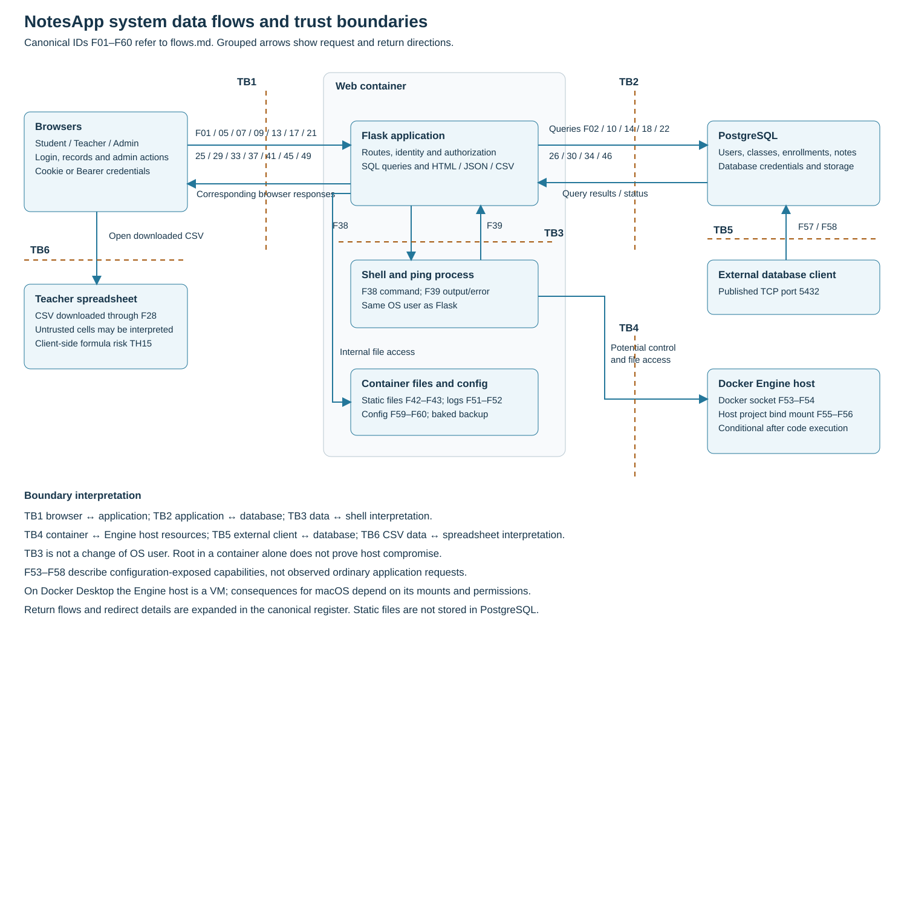
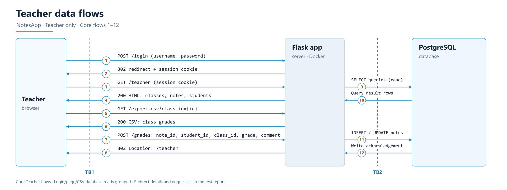
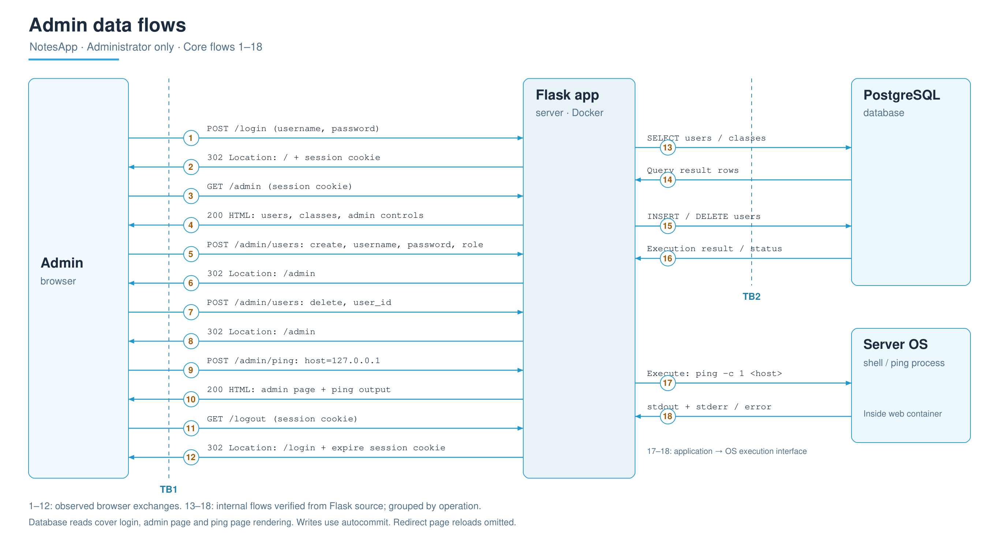

# NotesApp threat model and risk analysis

Submitted by: **Lv Songyuan** — Student ID: **2023901706**.

**P1 group:** Lv Songyuan (2023901706), Liu Yunfei (2023905324), Wu Siyuan (2023905932).

Group membership was confirmed by the student on 26 October 2026. There is no separate group repository; this fork contains Lv Songyuan’s submission. This identification does not claim that the other members have submitted or approved this revision. Group source materials are credited below.

This assessment identifies threats to student grades, teacher comments, user identities and the NotesApp runtime. The highest-priority findings are login SQL injection, a published session-signing secret, and acceptance of forged API tokens. The group’s flow diagrams and 17-threat register are retained, with consistent references, risk estimates and proposed fixes.

[Requirements and submission checklist](SUBMISSION_CHECKLIST.md) · [Flow register](flows.md) · [Three minute presentation](presentation.md) · [Group handoff in Chinese](HANDOFF_中文.txt)

## Scope and assumptions

The assessed version is repository commit `1c83e422429c4b784411701ffd797b5ab5f397dc`, using the original `web/`, `db/` and Docker Compose configuration. The separate `session03/task3_notesapp` encryption exercise is excluded. All source line numbers below refer to this fixed baseline, not the current main branch. Later security labs do not change this baseline risk assessment.

Policy follows the project README: students read their own grades, teachers manage grades for their assigned classes, and administrators manage user accounts. Administrative status does not grant a legitimate right to run arbitrary operating-system commands. Where the intended policy differs, ownership findings must be reconsidered.

Risk scores use a hypothetical deployment of this unchanged teaching application on a network reachable by untrusted clients, with its source and default configuration available. They are not estimates of attack activity on the student's loopback-only browsing session. The database port and web port are published in Compose; actual external reachability depends on host configuration. Default seeded account passwords are also a deployment precondition to remove; they overlap the identity-compromise findings rather than forming a separate ranked row.

### Assets and intended access

| Asset | Security objective and intended access |
|---|---|
| Grades, enrollments and class assignments | Integrity; students read their own grades, teachers manage assigned classes, enrollment and grade-range rules apply to writes. |
| Teacher comments | Confidentiality and integrity under the same record-access policy as grades. |
| Passwords, signing keys and session/JWT credentials | Prevent disclosure, forgery and unauthorized reuse; only the authentication service should handle secrets. |
| User identities and roles | Administrators manage accounts; clients cannot choose a more privileged identity or role. |
| Logs and change history | Preserve attribution and reliable evidence of sensitive actions. |
| Application, database and host resources | Availability and isolation; ordinary users and app processes must not gain unrestricted host control. |

### Evidence and confidence

- **Group-recorded behavior:** supplied flow notes describe role pages, redirects, normal admin actions and teacher exchanges. The administrator notes report a successful localhost ping. Redirects alone do not prove that account creation/deletion changed the database.
- **Student-reported behavior:** a student reported reading another student's grades, and supplied a teacher-page HTTP capture. Exact cross-user reproduction details remain to be attached if required.
- **Code-supported findings:** the implementation and configuration support the threat mechanisms listed below. This review did not perform exploit, CSRF, CSV-formula or denial-of-service tests. Risk scores are analytical estimates, not measurements.

## Data flow diagrams and trust boundaries

Use the [canonical flow register](flows.md) for the payload and direction of every numbered arrow and the local-to-global diagram cross reference. F01–F44 retain the group numbering. F45–F62 add health checks, redirects, logging, configuration, conditional host/database access and ping network traffic.

| Boundary | Meaning and flows |
|---|---|
| TB1 | Untrusted browser or network client to Flask. Identity and authorization decisions occur here; all browser requests and responses cross it. |
| TB2 | Flask service to PostgreSQL, authenticated by a database account. Queries and results cross a service/storage boundary even though both containers share a Docker network. |
| TB3 | Untrusted host text interpreted by the shell/ping execution interface, F38–F39. This is an interpreter boundary within the web container, not OS process privilege isolation. |
| TB4 | Web container to Docker Engine host and host project files, F53–F56. Socket and bind mounts weaken container isolation. On Docker Desktop, Engine-host control is not automatically equivalent to unrestricted control of the macOS host. |
| TB5 | Potential external client to published PostgreSQL port, F57–F58. This path bypasses web authorization and relies on database/network controls. |
| TB7 | Ping process to a network destination and, for hostnames, its resolver, F61–F62. The admin-supplied destination crosses an outbound network boundary; loopback-only pings remain local. |
| TB6 | Downloaded CSV content interpreted by a teacher's spreadsheet application. Browser export delivery is F28; subsequent formula evaluation is a downstream client trust decision. |

Student, teacher and administrator are separate logical permission domains enforced at TB1 and in record-level queries; sharing a browser box does not grant shared permissions.

Static assets, local logs, packaged config and backup files are shown as internal resources, not assumed to be separate privilege domains. Database and image backups outside the supplied configuration, internet identity providers and unrelated systems are outside scope. TLS is not configured in the assessed default deployment. Detailed network segmentation is a proposed improvement, not an existing control.

### Group role diagrams

These role figures abbreviate redirects and group database reads. Their local IDs must not be used directly as the threat table's global IDs. The [original handwritten overview](assets/group-overview.jpg) is retained as supporting work; its static-file database arrows are corrected in the system overview and canonical register.

## Risk scoring method

Risk = likelihood × impact, using ordinal scores from 1 to 5. Multiplication supports prioritization, not a numerical probability or expected financial loss. Related threats and attack chains are not added together.

| Score | Likelihood in the stated deployment | Impact if the scenario succeeds |
|---|---|---|
| 1 | Exceptional prerequisites; largely theoretical | Negligible, readily reversible effect |
| 2 | Several uncommon conditions or user-dependent steps | Limited effect on one noncritical function |
| 3 | Credible but needs privilege, access, victim behavior or uncertain capacity | Material effect on a limited set of records or accountability |
| 4 | Straightforward for an ordinary authenticated actor | Broad grade disclosure/tampering or service-wide interruption |
| 5 | Directly exposed, low-complexity path without an account | Administrative, credential-wide or runtime/host compromise |

Bands: 1–4 Low; 5–9 Moderate; 10–16 High; 17–25 Critical. These scales and bands are assessment choices, not values prescribed by the assignment.

## STRIDE register and ratings

S = Spoofing; T = Tampering; R = Repudiation; I = Information disclosure; D = Denial of service; E = Elevation of privilege. A threat may affect multiple categories. Same-role access to another user's resources is described explicitly; an E label here includes exceeding the intended authorization scope, not necessarily changing the stored role.

| Threat | STRIDE | Scope | L | I | Risk | Level |
|---|---|---|---:|---:|---:|---|
| TH01 | S T E | F01–F04 / TB1 TB2 | 5 | 5 | 25 | Critical |
| TH02 | S E | F04 and session-protected routes / TB1 | 5 | 5 | 25 | Critical |
| TH03 | S I | F13–F16 / TB1 | 5 | 4 | 20 | Critical |
| TH04 | I | F13–F16 / TB1 TB2 | 4 | 4 | 16 | High |
| TH05 | I E | F17–F20 F25–F28 / TB1 TB2 | 4 | 4 | 16 | High |
| TH06 | T E | F21–F24 / TB1 TB2 | 4 | 4 | 16 | High |
| TH07 | T I | F21–F24 then F09–F12 or F17–F20 / TB1 TB2 | 3 | 4 | 12 | High |
| TH08 | T E | F07–F08 F21–F24 F33–F40 / TB1 | 3 | 4 | 12 | High |
| TH09 | S T I | TB1 / HTTP deployment | 3 | 5 | 15 | High |
| TH10 | I | PostgreSQL and container backups / TB2 TB4 TB5 | 3 | 5 | 15 | High |
| TH11 | R | F01–F40 F51–F52 / logging | 4 | 3 | 12 | High |
| TH12 | D | HTTP routes and F51–F52 | 3 | 4 | 12 | High |
| TH13 | T D E | F37–F40 / TB1 TB3 | 3 | 5 | 15 | High |
| TH14 | E | F38 F53–F56 / TB4 | 3 | 5 | 15 | High |
| TH15 | T I | F21–F28 / TB6 | 2 | 4 | 8 | Moderate |
| TH16 | T | F21–F24 / TB2 | 4 | 3 | 12 | High |
| TH17 | S I | F04 F07–F08 F12–F16 / TB1 | 3 | 4 | 12 | High |

### TH01

Concatenated login SQL allows attacker-controlled credentials to change query logic and potentially authenticate as another user.

**Evidence:** `web/app.py:142–174, login`.

**Likelihood 5:** Unauthenticated input reaches SQL directly; the source is available. **Impact 5:** An administrative identity enables broad account and grade operations.

**Mitigation:** Use bound SQL parameters, generic failures, least-privilege DB access and modern password hashing.

### TH02

The published Flask signing secret permits creation of accepted session data, including a privileged role.

**Evidence:** `web/app.py:29–33,119–125; docker-compose.yml:27`.

**Likelihood 5:** The configured secret is present in the supplied source; no prior account is required. **Impact 5:** A forged administrator session exposes all administrative actions.

**Mitigation:** Replace and rotate the secret outside Git, invalidate old sessions, and check current roles against trusted server-side records.

### TH03

The API accepts unsigned JWTs and a weak published HMAC key, allowing a forged Bearer identity to pass its authentication check.

**Evidence:** `web/app.py:67–115,202–222`.

**Likelihood 5:** An unsigned-token branch accepts a payload without verifying a signature. **Impact 4:** All grade records may be disclosed through the API; this path does not authenticate browser admin pages.

**Mitigation:** Use a maintained JWT library, pin the allowed algorithm, reject unsigned tokens, protect keys and validate identity and claims; enforce note ownership separately.

### TH04

A logged-in student can request another student’s note because the API selects by record ID without checking ownership.

**Evidence:** `web/app.py:202–222; student observation reported in conversation`.

**Likelihood 4:** Requires an ordinary authenticated student account; changing a note ID then reaches an unscoped query. This matches the scale for authenticated access. Forging identity without an account is assessed separately as TH03. **Impact 4:** Grades and private comments across students can be disclosed.

**Mitigation:** Scope queries to the current student; define explicit teacher/admin policies and test the permission matrix.

### TH05

A teacher can view or export classes assigned to other teachers because class ownership does not restrict the queries.

**Evidence:** `web/app.py:226–244,276–306; README role policy`.

**Likelihood 4:** An ordinary teacher account can use the normal page or export endpoint. **Impact 4:** Bulk disclosure extends beyond the teacher’s assigned classes.

**Mitigation:** Filter classes and exports by the authenticated teacher ID; reject unauthorized class IDs.

### TH06

A teacher can create or update grades in another teacher’s class when the route checks the teacher role but not class ownership.

**Evidence:** `web/app.py:248–272`.

**Likelihood 4:** Teacher credentials and a chosen record/class ID are sufficient prerequisites in the code. **Impact 4:** Unauthorized changes undermine academic records across classes.

**Mitigation:** Verify class ownership and enrollment in the write transaction; constrain updates by both record and authorized class.

### TH07

An actor allowed to write a comment can store active HTML/script that is rendered without escaping to another user.

**Evidence:** `web/templates/dashboard.html:15; web/templates/teacher.html:47`.

**Likelihood 3:** Requires comment-write access and a victim viewing the stored content. **Impact 4:** Script can alter displayed data and act in the victim browser; HttpOnly does not stop same-origin actions.

**Mitigation:** Restore autoescaping; if rich text is necessary apply a strict sanitizer, and add CSP as defense in depth.

### TH08

Missing CSRF validation can allow unwanted state changes when a victim browser sends a session cookie with an attacker-induced request.

**Evidence:** `web/app.py:179–181,248–272,325–341,363–379; no CSRF integration`.

**Likelihood 3:** Requires a logged-in victim and a request context where browser cookie rules permit the cookie. **Impact 4:** Teacher or admin actions could be induced; ping consequences may chain to TH13.

**Mitigation:** Add server-validated CSRF tokens to mutations, use POST logout, check origins and set SameSite explicitly.

### TH09

On an accessible untrusted network, plaintext HTTP can expose credentials/session cookies and allow response or request modification.

**Evidence:** `docker-compose.yml:29–30; web/app.py:392–394; recorded HTTP observation`.

**Likelihood 3:** Requires network positioning; the observed loopback capture does not establish interception. **Impact 5:** A stolen privileged session can compromise administrative operations.

**Mitigation:** Deploy HTTPS, set Secure and HttpOnly cookies, choose SameSite, and restrict development bindings to loopback.

### TH10

Database access exposes plaintext passwords/comments; container-image access also exposes a baked password backup.

**Evidence:** `db/init.sql:8–35; web/Dockerfile:17–23; docker-compose.yml:11–12`.

**Likelihood 3:** Requires database, image, backup or filesystem access; published database settings broaden exposure if reachable. **Impact 5:** Credential disclosure enables account compromise and reveals private records.

**Mitigation:** Hash passwords with Argon2id or another suitable password KDF; encrypt sensitive comments with separately managed keys; remove baked secrets/backups and restrict DB access.

### TH11

Incomplete, locally writable audit records leave insufficient evidence to attribute or reconstruct reads and administrative changes.

**Evidence:** `web/app.py:38–44,170–175,271,339; web/Dockerfile:20–22`.

**Likelihood 4:** Normal sensitive operations omit key audit fields; code can silently ignore logging failures. **Impact 3:** Disputes and incident reconstruction become difficult even when data is still available.

**Mitigation:** Record actor, action, target, outcome and time; capture protected change history, centralize append-only logs, and alert on failures.

### TH12

Unbounded result sets, no application rate limiting and growing logs may exhaust database, worker or disk resources.

**Evidence:** `web/app.py:38–44,226–244,276–306; Compose has no resource limits`.

**Likelihood 3:** Repeated traffic is possible, but practical thresholds depend on host resources and middleware. **Impact 4:** Service-wide unavailability could block grade access and updates.

**Mitigation:** Add rate limits, pagination, request-size limits, timeouts, log rotation and container quotas; validate with a bounded authorized load test.

### TH13

The administrator-controlled host string is concatenated into a shell command, enabling command execution beyond the intended ping function.

**Evidence:** `web/app.py:325–341; web/Dockerfile:24`.

**Likelihood 3:** Requires an administrator session, possibly obtained through TH01 or TH02. **Impact 5:** Commands run with the web process privileges and can damage the service or lead to TH14.

**Mitigation:** Avoid shell=True, validate destinations, use fixed executable arguments, restrict egress across TB7 (F61–F62), and run the process with minimal privileges.

### TH14

Code execution in a root web container may allow control of the Docker Engine through the mounted socket and modification of bind-mounted project files.

**Evidence:** `docker-compose.yml:35–37; web/Dockerfile:24`.

**Likelihood 3:** Requires code execution and usable socket permissions; root alone is not a container escape. **Impact 5:** Compromise can extend to the Docker Engine host and other workloads.

**Mitigation:** Remove the Docker socket and broad host mount, use a non-root user and read-only filesystem, drop capabilities and isolate the runtime.

### TH15

An attacker-written comment exported as CSV may be treated as a formula by a spreadsheet application.

**Evidence:** `web/app.py:298–305; OWASP CSV Injection`.

**Likelihood 2:** Requires a writable comment, teacher download and spreadsheet behavior/settings that evaluate the cell. **Impact 4:** Spreadsheet content or accessible information may be affected; exfiltration depends on application controls.

**Mitigation:** Export untrusted cells as explicit text using a tested spreadsheet-safe policy; quoting CSV alone does not neutralize formulas.

### TH16

The grade route does not enforce a business grade range or verify that the selected user is an enrolled student in the class.

**Evidence:** `web/app.py:248–268; db/init.sql notes/enrollments definitions`.

**Likelihood 4:** A teacher can submit values directly; foreign keys do not enforce role, enrollment or grade policy. **Impact 3:** False academic records or out-of-policy grades can be stored.

**Mitigation:** Agree the allowed grade range, validate role/enrollment and numeric input, then enforce appropriate database constraints.

### TH17

Issued JWTs lack expiry and copied tokens can still be used at the API after logout clears the browser session.

**Evidence:** `web/app.py:67–102,167–169,179–181,202–207`.

**Likelihood 3:** Requires a previously copied token; logout does not implement token revocation. **Impact 4:** Grade access may persist beyond the intended session.

**Mitigation:** Require expiry and issuer/audience validation, short lifetimes and a revocation/version mechanism; revoke on logout when policy requires it.

## The three highest priority risks

TH01 and TH02 both score 25; they are tied for first priority. TH03 scores 20 and is third. TH04 scores 16 because it requires an authenticated account; it remains an independent authorization defect after JWT verification is fixed. TH05 and TH06 also score 16. The ordering of the tied first two risks is a presentation choice, not a claim of different numerical risk.

### Priority 1 TH01 Login SQL injection

**Risk 25.** Unauthenticated credential input is concatenated into a SQL query. A changed query may produce another user's identity and administrative access.

**Fix:** use parameterized database queries and a dedicated password-hash verification step; restrict the database account's privileges and avoid exposing raw database errors. Password hashing alone does not fix injection, and rate limiting alone does not remove it.

**Acceptance checks:** valid credentials still work; incorrect credentials fail; quotes and SQL-like strings are treated strictly as values; no rejected login creates a session or exposes database error details. Review the query construction in code as well as testing outcomes.

### Priority 2 TH02 Published session signing secret

**Risk 25.** The application trusts session identity and role fields signed with a secret distributed in the project configuration. Anyone knowing that secret may create accepted session data without possessing a user's password.

**Fix:** generate a strong deployment-specific secret outside source control, rotate the exposed secret and invalidate old sessions. Resolve sensitive roles from trusted server-side state and enforce authorization at every operation. Protect transport and cookies as additional controls.

**Acceptance checks:** new legitimate sessions work; sessions signed with the old secret fail; modified role data fails; revoked accounts and role changes take effect on protected endpoints. Check repository, image and logs for leaked replacement secrets without publishing them.

### Priority 3 TH03 Forged API tokens

**Risk 20.** The custom verifier accepts `alg: none` and uses a published weak HMAC key. A forged Bearer token can pass the API identity gate. This is not evidence that browser-only teacher/admin routes accept that token.

**Fix:** replace the custom verifier with a maintained library, allow only the selected signed algorithm, protect and rotate keys, require expiry and intended issuer/audience, and resolve a valid current identity. Independently enforce ownership on `/api/notes/<id>` to fix TH04; correct token verification alone is insufficient.

**Acceptance checks:** unsigned, wrong-key, malformed and expired tokens return 401; a valid student token can read an allowed record but not another student's record; invalid-token failures do not return server errors or leak grades. Test cookie-authenticated API access too.

### Attack chain and parallel containment

TH01 or TH02 may provide the administrator session needed for TH13. Shell execution can then expose TH14 through the Docker socket. Keep TH13 and TH14 as separate findings with their own prerequisites; do not treat them as independently unauthenticated paths or add their scores. Remove the socket and shell interpretation promptly even though they are not among the three largest individual scores.

## Coverage and limitations

All six categories are covered: S by TH01/02/03/09/17; T by TH01/06/07/08/09/13/15/16; R by TH11; I by TH03/04/05/07/09/10/15/17; D by TH12/13; E by TH01/02/05/06/08/13/14. Every threat has likelihood, impact, rationale and a mitigation.

CSRF feasibility depends on the actual browser and cookie context. An unset SameSite configuration is not proof that every cross-site POST carries a cookie. CSV risk depends on the spreadsheet's import and evaluation behavior. Denial-of-service capacity and host-level consequences are hypotheses supported by configuration, not demonstrated outcomes. The app also runs in debug mode; disabling the development debugger is part of deployment hardening, without assuming that its interactive console is accessible.

The fixes in this baseline report are proposals with acceptance criteria, not a claim that all defects have been remediated. Subsequent commits implement selected login, ownership, encryption, HMAC, HTTPS and password-hashing changes; see the repository README for their separate scope and tests. Authorized testing should use disposable course data, redact credentials/tokens, and avoid disruptive load or destructive actions.

## Sources and contribution note

Primary evidence: [application source](https://github.com/NoahLightryyy/NoteApp/blob/1c83e422429c4b784411701ffd797b5ab5f397dc/web/app.py), [templates](https://github.com/NoahLightryyy/NoteApp/tree/1c83e422429c4b784411701ffd797b5ab5f397dc/web/templates), [database seed/schema](https://github.com/NoahLightryyy/NoteApp/blob/1c83e422429c4b784411701ffd797b5ab5f397dc/db/init.sql), [Docker configuration](https://github.com/NoahLightryyy/NoteApp/blob/1c83e422429c4b784411701ffd797b5ab5f397dc/docker-compose.yml), [image configuration](https://github.com/NoahLightryyy/NoteApp/blob/1c83e422429c4b784411701ffd797b5ab5f397dc/web/Dockerfile), and [project role policy](https://github.com/NoahLightryyy/NoteApp/blob/1c83e422429c4b784411701ffd797b5ab5f397dc/README.md), at the commit stated above. The original group files are retained in [group-materials](group-materials/).

Technical references: [Flask cookie configuration](https://flask.palletsprojects.com/en/stable/config/), [Flask 3.0.3 defaults](https://github.com/pallets/flask/blob/3.0.3/src/flask/app.py), and [OWASP CSV injection](https://community.owasp.org/attacks/CSV_Injection).

Group-provided material supplied the diagrams, flow descriptions and initial threat register. AI assistance was used to organize the submission, check code references, add boundary details, and propose the risk ratings, mitigations and presentation wording. The group should review these judgments and disclose assistance as required by the course policy.
